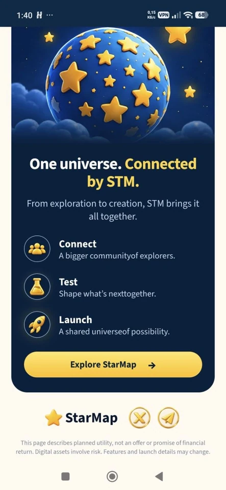

# StarMap - сайт проекта и токена

Автор проекта - **Евгений Толмачев**. [Профиль GitHub](https://github.com/EvgenyET) · [Проект в портфолио](https://evgeny-dev.pro/project.html?id=StarMap_site)

Два адаптивных промосайта StarMap. Презентация звёздной карты и коллекции, отдельная страница токена, дорожная карта и переходы в браузерное и Telegram-приложения.

## Задача проекта

Задача промосайтов - провести посетителя от первого знакомства к запуску приложения. У страниц общий визуальный язык, но разные информационные акценты. Дизайн учитывает крупные иллюстрации, длинные информационные разделы и навигацию на небольшом экране.

## Мой вклад

Подготовил структуру двух страниц, тексты разделов и их оформление в стиле StarMap. Разработал адаптивную вёрстку, мобильную навигацию, разделы механики карты и дорожной карты, переходы в приложения и сообщество. Организовал общие ресурсы оформления и настройки индексации основного сайта.

## Интерфейс

**Первый экран основного сайта StarMap**

**Мобильная страница токена StarMap**

## Как работает приложение

Промосайты StarMap знакомят нового посетителя с картой звёзд и экосистемой проекта. Основная страница объясняет идею коллекции и предлагает открыть приложение в браузере или Telegram. Вторая посвящена токену и плану развития. Общий персонаж, иллюстрации и типографика связывают страницы визуально, а мобильные версии сохраняют понятную последовательность разделов и основные действия.

## Возможности

- Основной сайт с презентацией звёздной карты и механики коллекции.
- Отдельная страница токена экосистемы.
- Информационные разделы и дорожная карта проекта.
- Прямой выбор между браузерным приложением и Telegram.
- Мобильное меню и адаптивная композиция иллюстраций и текста.
- Общие графические ресурсы и типографика двух страниц.

## Техническое устройство

### Основной сайт

Основная страница ведёт от презентации звёздной карты к выбору приложения. Навигация и ссылки запуска доступны и через мобильное меню.

### Страница токена

У страницы токена собственная последовательность разделов об экосистеме и плане развития. Она открывается отдельно от игрового кабинета и карты.

### Общие ресурсы

Обе страницы подключают ресурсы из site-assets. Там собраны стили заголовков, дорожной карты, ссылок сообщества и мобильной навигации.

## Технологии

| Технология | Роль в проекте |
| --- | --- |
| HTML5 | Две самостоятельные точки входа. |
| CSS и JavaScript | Адаптивная графика, навигация и поведение элементов. |
| Sitemap и robots.txt | Настройки обхода основного сайта. |

## Демонстрация

На странице портфолио доступны описание, галерея и видеодемонстрация проекта. [Открыть StarMap - сайт проекта и токена](https://evgeny-dev.pro/project.html?id=StarMap_site).
