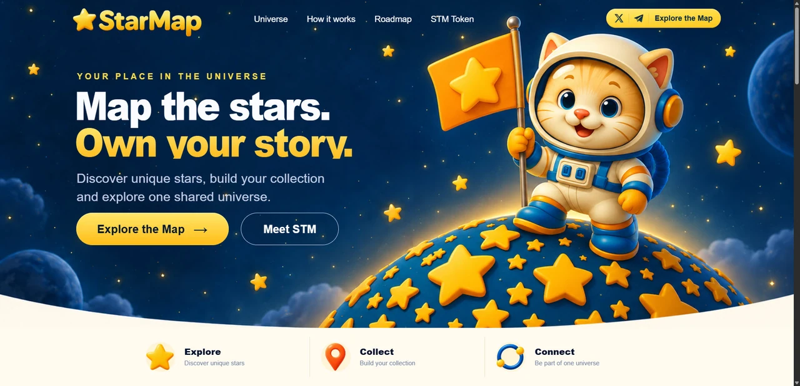

# StarMap - сайт проекта и токена

**Автор проекта:** [Евгений Толмачев](https://github.com/EvgenyET) · [Страница проекта в портфолио](https://evgeny-dev.pro/project.html?id=StarMap_site)

Два промосайта StarMap. Основной знакомит со звёздной картой, второй посвящён токену экосистемы.

## Мой вклад

Подготовил два промосайта StarMap с общей графикой и разными задачами. На основном сайте объяснил механику карты и коллекции, а на странице токена собрал информацию об экосистеме. Для обеих страниц разработал мобильную вёрстку.

## Интерфейс

**Первый экран основного сайта StarMap**

**Мобильная страница токена StarMap**

## Как это работает

На starmap.top посетитель знакомится с картой и выбирает переход в веб-приложение или Telegram. На token.starmap.top собраны сведения о токене и его месте в проекте.

## Возможности

- Презентация карты и возможностей проекта.
- Отдельная страница токена и план развития.
- Переходы в веб-приложение, Telegram и сообщество.

## Технологии

- **HTML5** - Две самостоятельные точки входа.
- **CSS и JavaScript** - Адаптивная графика, навигация и поведение элементов.
- **Sitemap и robots.txt** - Настройки обхода основного сайта.

## О проекте

Обе страницы используют общий визуальный язык StarMap. Для каждой подготовлены собственные иллюстрации и мобильная компоновка. В галерее можно выбрать домен и тип экрана.

Коммерческий проект. Исходный код закрыт.
